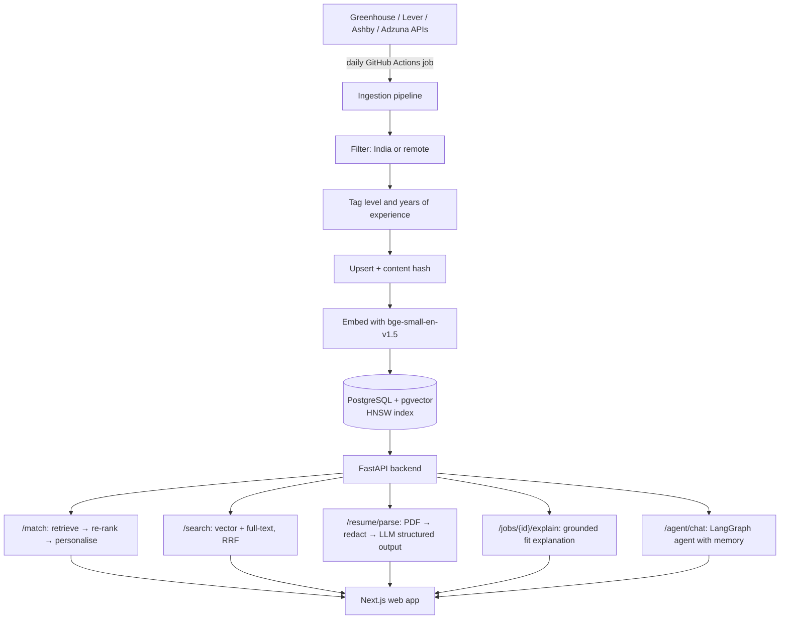

<div align="center">

# InternMatch

**AI-powered internship matching for students.**
Upload a resume, get live internships ranked by fit, see the skills you're missing, and ask an AI agent what to do next.


</div>

---

## Table of Contents

- [Overview](#overview)
- [Key Features](#key-features)
- [How It Works](#how-it-works)
- [Tech Stack](#tech-stack)
- [Getting Started](#getting-started)
- [Configuration](#configuration)
- [API Reference](#api-reference)
- [Evaluation](#evaluation)
- [Testing](#testing)
- [Deployment](#deployment)
- [Project Structure](#project-structure)
- [Design Decisions](#design-decisions)
- [Known Limitations](#known-limitations)
- [Roadmap](#roadmap)

---

## Overview

### The problem

Students outside top colleges rarely hear about off-campus internships in time. Openings are spread across
hundreds of company career pages, most listings on job portals need years of experience, and a student has no
easy way to tell which roles actually fit their skills.

### The solution

InternMatch collects live postings every day from official company job-board APIs, keeps only roles that are
open to students in India or remote, and ranks them against each student's profile. For every role it shows
the skills the student already has, the skills they are missing, and how to prepare.

---

## Key Features

| Feature | Description |
|---|---|
| **Live job index** | Daily ingestion from Greenhouse, Lever and Ashby job boards (43 companies such as Groww, Meesho, CRED, Paytm, Sarvam AI, Databricks, MongoDB) plus the Adzuna India API. Edited postings are re-embedded and closed postings are deactivated. |
| **Resume parsing** | PDF → text → contact details redacted → LLM returns a schema-validated profile (skills, target roles, education, experience). Resumes are never stored. |
| **Personalised ranking** | Vector retrieval on pgvector, then re-ranking on semantic fit, skill coverage, experience level and recency. *Save* and *Not for me* adapt the ranking to each student (Rocchio feedback). |
| **Skill-gap analysis** | Every match shows matched and missing skills from a curated vocabulary of ~90 technical skills. |
| **Explain my fit** | One structured LLM call returns a fit score, matched and missing skills, and up to three preparation steps, grounded in the posting. |
| **AI career agent** | A LangGraph tool-calling agent that searches jobs, recommends roles, reads postings and checks skill gaps, with per-session memory. |
| **Hybrid search** | Free-text search that fuses vector and full-text results with reciprocal rank fusion. |
| **Offline evaluation** | Ranking metrics (P@k, nDCG, MRR) against student personas and an LLM grounding check. |

---

## How It Works



### Ranking pipeline

1. **Retrieve** – 150 nearest postings by cosine similarity (HNSW) plus 50 full-text matches.
2. **Filter** – experience level (internship / entry level), remote only, city, maximum years of experience.
3. **Re-rank** – weighted score:

   | Signal | Weight | Source |
   |---|---|---|
   | Semantic similarity | 0.60 | profile embedding vs posting embedding |
   | Experience level | 0.25 | internship > entry level > other |
   | Skill coverage | 0.10 | profile skills found in the posting |
   | Recency | 0.05 | exponential decay, 30-day scale |

4. **Personalise** – the query vector moves toward saved roles (+0.35) and away from hidden roles (−0.20).

---

## Tech Stack

| Layer | Technology |
|---|---|
| Backend | Python 3.12, FastAPI, SQLAlchemy 2, Pydantic |
| AI / LLM | Groq (`openai/gpt-oss-120b`), LangChain, LangGraph |
| Embeddings | fastembed `BAAI/bge-small-en-v1.5` (384-dim, runs locally) |
| Database | PostgreSQL + pgvector (HNSW), full-text search |
| Frontend | Next.js 16 (App Router), React 19, TypeScript, Tailwind CSS 4 |
| Tooling | uv, pytest, ESLint, Docker |
| CI/CD | GitHub Actions (tests, build, daily job refresh) |
| Hosting | Render (API), Vercel (web), Neon (database) – all free tiers |

---

## Getting Started

### Prerequisites

- [uv](https://docs.astral.sh/uv/) (installs Python 3.12 automatically)
- Node.js 20+
- A free [Groq API key](https://console.groq.com/keys)

No Docker or database installation is needed for local development: `DATABASE_URL=local` starts an embedded
PostgreSQL with pgvector inside `backend/.pgdata`.

### 1. Clone

```bash
git clone https://github.com/bhargavi-46/InternMatch.git
cd InternMatch
```

### 2. Backend

```bash
cd backend
uv sync
cp .env.example .env              # add your GROQ_API_KEY
uv run python -m app.ingest.run   # fetch and embed jobs (first run ~8 min)
uv run uvicorn app.main:app --port 8000
```

API docs are available at http://localhost:8000/docs.

### 3. Frontend

```bash
cd frontend
npm install
npm run dev
```

Open http://localhost:3000.

> **Tip:** Without a Groq key, matching and search still work. Type your skills in instead of uploading a resume.

---

## Configuration

### Backend (`backend/.env`)

| Variable | Required | Default | Description |
|---|---|---|---|
| `DATABASE_URL` | Yes | `local` | `local` for embedded Postgres, or a PostgreSQL connection string (e.g. Neon) |
| `GROQ_API_KEY` | For AI features | – | Resume parsing, fit explanations, chat |
| `GROQ_MODEL` | No | `openai/gpt-oss-120b` | Any Groq chat model with structured output |
| `ADZUNA_APP_ID` | No | – | Adds internship and fresher listings across India |
| `ADZUNA_APP_KEY` | No | – | Used with `ADZUNA_APP_ID` |
| `CORS_ORIGINS` | No | `http://localhost:3000` | Comma-separated frontend URLs |

### Frontend (`frontend/.env.local`)

| Variable | Required | Default | Description |
|---|---|---|---|
| `NEXT_PUBLIC_API_URL` | No | `http://localhost:8000` | Backend base URL |

All external services used have a free tier: [Groq](https://console.groq.com),
[Adzuna](https://developer.adzuna.com), [Neon](https://neon.tech), [Render](https://render.com),
[Vercel](https://vercel.com).

---

## API Reference

| Method | Endpoint | Description | Rate limited |
|---|---|---|---|
| `GET` | `/health` | Health check | |
| `GET` | `/stats` | Index size, student roles, companies, last refresh | |
| `GET` | `/jobs` | List active jobs with filters | |
| `GET` | `/jobs/{id}` | Job details | |
| `POST` | `/search` | Hybrid free-text search | |
| `POST` | `/match` | Ranked matches for a profile, with saved / hidden feedback | |
| `POST` | `/resume/parse` | PDF resume (≤ 5 MB) → structured profile | ✔ |
| `POST` | `/jobs/{id}/explain` | LLM fit explanation for one job | ✔ |
| `POST` | `/agent/chat` | Conversational agent, memory per `thread_id` | ✔ |

LLM endpoints are limited to 30 calls per 10 minutes per IP to stay within the Groq free quota.
Full request and response schemas are in the interactive docs at `/docs`.

---

## Evaluation

Ranking quality is measured on the live index against student personas (ML/AI, backend, frontend, security,
product, support engineering). A posting is relevant when its title matches the persona's role and it is an
internship (gain 2) or entry-level role (gain 1).

| Method | P@5 | P@10 | nDCG@10 | MRR |
|---|---|---|---|---|
| Keyword (Postgres full-text) | 0.000 | 0.000 | 0.000 | 0.000 |
| Semantic (pgvector) | 0.267 | 0.150 | 0.505 | 0.531 |
| Hybrid (RRF) | 0.067 | 0.067 | 0.226 | 0.188 |
| **InternMatch ranker** | **0.300** | **0.200** | **0.745** | **0.806** |

*1,010 active jobs, 6 personas, top-10 results.* Ranker weights were chosen with a small sweep on the same
personas, so treat the gap as indicative. Absolute precision is limited by supply: only ~30 postings in the
index are student roles on a given day.

```bash
cd backend
uv run python -m app.evals.run          # ranking metrics → eval_results.md
uv run python -m app.evals.run --llm    # adds the LLM grounding check
```

---

## Testing

```bash
# Backend: unit and API tests
cd backend && uv run pytest

# Frontend: lint and production build
cd frontend && npm run lint && npm run build
```

Both run on every push and pull request through GitHub Actions (`.github/workflows/ci.yml`).

---

## Deployment

| Step | Service | Action |
|---|---|---|
| 1 | **Neon** | Create a project and copy the connection string. |
| 2 | **GitHub Actions** | Add repository secrets `DATABASE_URL` (and optionally `ADZUNA_APP_ID`, `ADZUNA_APP_KEY`). Run the *Refresh jobs* workflow once; it then runs daily at 08:00 IST. |
| 3 | **Render** | *New → Blueprint* → select this repo (`render.yaml`). Set `DATABASE_URL`, `GROQ_API_KEY`, `CORS_ORIGINS`. |
| 4 | **Vercel** | Import the repo with root directory `frontend` and set `NEXT_PUBLIC_API_URL` to the Render URL. |

To run the full stack in containers instead: `docker compose up`.

> Render's free plan sleeps after 15 minutes of inactivity; the first request afterwards takes about a minute.

---

## Project Structure

```
InternMatch/
├── backend/
│   ├── app/
│   │   ├── ingest/          # job-board + Adzuna fetchers, filters, upsert, embedding
│   │   ├── evals/           # personas, metrics, evaluation runner
│   │   ├── main.py          # FastAPI app and routes
│   │   ├── ranking.py       # retrieval, rank fusion, re-ranking, personalisation
│   │   ├── agent.py         # fit explanations + LangGraph agent
│   │   ├── resume.py        # PDF parsing + LLM profile extraction
│   │   ├── skills.py        # skills vocabulary and extraction
│   │   ├── embeddings.py    # local embedding model
│   │   ├── db.py, models.py # database engine and schema
│   │   └── ratelimit.py     # per-IP rate limiting
│   ├── tests/               # pytest suite
│   ├── Dockerfile
│   └── pyproject.toml
├── frontend/
│   └── src/
│       ├── app/             # Next.js pages and layout
│       ├── components/      # profile, filters, match cards, search, chat
│       └── lib/             # API client, types, storage helpers
├── .github/workflows/       # CI and daily job refresh
├── docker-compose.yml
└── render.yaml
```

---

## Design Decisions

- **Official APIs only.** Jobs come from public job-board APIs that companies publish; no scraping of sites whose terms forbid it.
- **Local embeddings.** `bge-small-en-v1.5` runs on CPU, so embedding costs nothing and needs no API key.
- **One database for everything.** pgvector keeps vectors, full-text search and relational filters in a single PostgreSQL query.
- **Structured LLM outputs.** Resume parsing and fit explanations use JSON-schema structured output, validated with Pydantic.
- **Privacy by default.** Emails and phone numbers are removed before a resume reaches the LLM, and resumes are never saved. Saved and hidden jobs live in the browser.

---

## Known Limitations

- Adzuna returns only a description snippet, so its matches rely more on job titles.
- Experience level is inferred from titles and "N years of experience" phrases and can be wrong for unusual wording.
- Agent memory is held in the API process and resets when the server restarts.

---

## Roadmap

- [ ] Email alerts for new high-fit internships
- [ ] More Indian company job boards
- [ ] Persistent agent memory in PostgreSQL
- [ ] Larger, hand-labelled evaluation set
